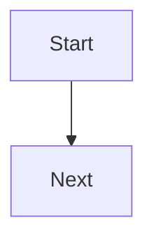

# Algo-trading architecture diagrams

This folder contains editable Mermaid source diagrams for the repository architecture.

## Files

- `project-architecture.mmd` — end-to-end system architecture: session controller, MCP server, Alpaca paper trading, CrewAI workflow, RAMS, LLMs, reports and GitHub logging.
- `agent-architecture.mmd` — the five-agent workflow and the Python orchestration between agent stages.

## View the diagrams

GitHub renders Mermaid diagrams in Markdown files. To display these diagrams directly in the repository, copy each diagram into a Markdown file inside a fenced `mermaid` code block, for example:

```markdown

```

The `.mmd` files are kept as editable source. The diagrams are based on the current `README.md`, `run_session.py`, `crew_ai/clients/trading_crew.py`, and `servers/alpaca_trading_mcpServer.py`. Update them when the implementation changes.

## Important interpretation

The news sentiment and technical analyst tasks run in parallel. The Market Data Agent summarizes the account and analyst findings. Python then recomputes final RAMS with news scores, builds the numbered trade plan, and passes it to the Risk Manager and Trader. The Trader selects from existing proposed orders; Python validates the response and the MCP server handles paper-order operations.
